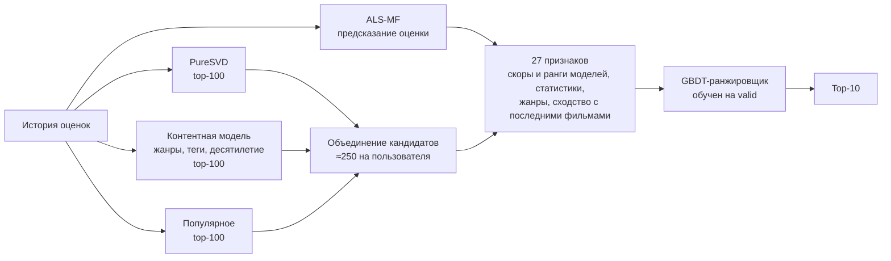
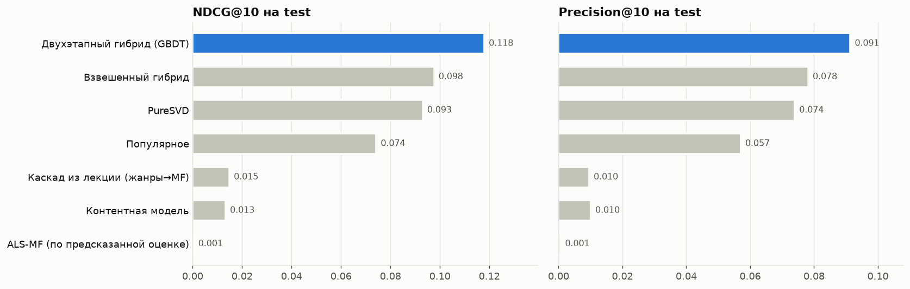
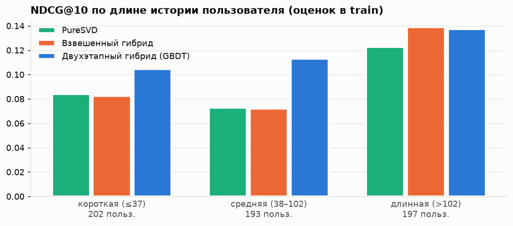
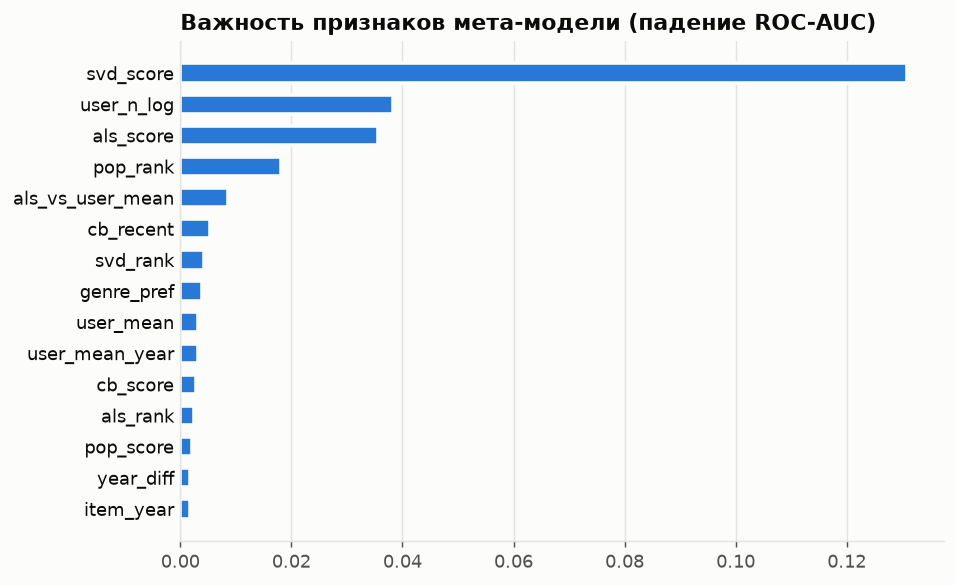

# GibridSys — гибридная рекомендательная система фильмов

Домашнее задание к теме **«Гибридные рекомендательные системы»** (Нетология, курс «Рекомендательные системы»).
Автор: **Александра Бужор** (Alexandra Bujor) · Telegram [@Angry_C_F_O](https://t.me/Angry_C_F_O)

**Задание:** взять датасет MovieLens ml-latest, вспомнить разобранные подходы, выбрать понравившийся подход к гибридным системам и написать свою систему.

Решение — в ноутбуке [`hybrid_recsys.ipynb`](hybrid_recsys.ipynb). Все выводы и графики уже сохранены в нём.

## Подход

На лекции разбирали два гибрида: **LightFM** (факторизация с признаками фильмов) и **каскад «контент → коллаборатив»**: 20 похожих по жанрам на последний фильм → переранжирование по SVD. Я выбрала каскадную схему и развила её в **двухэтапный гибрид «кандидаты → ранжирование»**:



* **Этап 1 — кандидаты** из трёх источников. Коллаборативный PureSVD находит фильмы, которые смотрят пользователи с похожим вкусом. Контентная модель (TF-IDF по жанрам и тегам, десятилетие выпуска, Tag Genome в полной ml-latest) подтягивает похожие фильмы, в том числе без оценок. Популярное подстраховывает.
* **Этап 2 — мета-модель** (`HistGradientBoostingClassifier`) учится на *будущих* оценках из `valid` и сама решает, как смешивать сигналы. Признаки: скоры и ранги всех моделей, предсказанная оценка ALS-MF, статистики фильма и пользователя, жанровые предпочтения и сходство с последними просмотренными фильмами (сигнал лекционного каскада, но в виде признака, а не жёсткого фильтра).
* **Холодный старт пользователя (switching):** при пустой истории — популярное с байесовским рейтингом по выбранным жанрам, при нескольких оценках — взвешенный гибрид с fold-in без переобучения.

Все компоненты написаны самостоятельно на `numpy / scipy / scikit-learn`: ALS для матричной факторизации, PureSVD, контентные профили, генерация признаков, метрики. Пакеты `surprise` и `lightfm` не нужны — ноутбук ставится без компилятора на Windows, macOS и Linux.

## Валидация

* Разбиение **временное по каждому пользователю**: последние 20 % оценок → `test`, из оставшегося последние 20 % → `valid`.
* Гиперпараметры компонентов, веса взвешенного гибрида и мета-модель подбираются **только на `valid`**. Перед проверкой на `test` компоненты переобучаются на `train + valid`.
* Релевантный фильм — оценка ≥ 4 в тестовом периоде. Просмотренное исключается из выдачи.
* Теги пар «пользователь–фильм» из valid/test удалены из контентных признаков: тег выдаёт факт просмотра.

## Результаты (ml-latest-small, 592 пользователя в test)

| Модель | Precision@10 | Recall@10 | NDCG@10 | MAP@10 | HitRate@10 | Coverage |
|---|---:|---:|---:|---:|---:|---:|
| Популярное | 0.0571 | 0.0496 | 0.0743 | 0.0355 | 0.3209 | 0.0101 |
| Контентная модель | 0.0101 | 0.0142 | 0.0134 | 0.0052 | 0.0912 | 0.1352 |
| ALS-MF (по предсказанной оценке) | 0.0007 | 0.0001 | 0.0005 | 0.0001 | 0.0068 | 0.0200 |
| PureSVD | 0.0740 | 0.0700 | 0.0931 | 0.0436 | 0.4037 | 0.0494 |
| Каскад из лекции (жанры→MF) | 0.0096 | 0.0130 | 0.0149 | 0.0069 | 0.0828 | 0.1818 |
| Взвешенный гибрид | 0.0782 | 0.0727 | 0.0977 | 0.0474 | 0.4105 | 0.0315 |
| **Двухэтапный гибрид (GBDT)** | **0.0914** | **0.0970** | **0.1180** | **0.0575** | **0.4949** | 0.0550 |



* **+27 % NDCG@10** к лучшей одиночной модели (PureSVD) и +21 % к взвешенному гибриду. Парный бутстреп по пользователям: 95 % ДИ разницы с PureSVD — [+0.014; +0.036], со взвешенным гибридом — [+0.009; +0.032].
* RMSE на test: среднее 1.069, модель смещений 0.917, ALS-MF 0.895. Но по предсказанной оценке ALS-MF ранжирует плохо: 92 % её top-10 — фильмы с 1–2 оценками. В гибриде она полезна как признак «понравится ли».
* Гибрид выигрывает у пользователей с короткой и средней историей: NDCG 0.104 и 0.113 против 0.084 и 0.073 у PureSVD. У самых активных он на уровне простого взвешенного гибрида.



* Абляция: без PureSVD NDCG падает до 0.095, без контентных признаков — до 0.101, без ALS — до 0.104, без популярности и статистик фильма — до 0.113. Надёжно здесь только первое место PureSVD: разброс мета-модели между запусками (±0.005–0.01 NDCG) сопоставим с разницей между остальными группами.



Подробный разбор, примеры рекомендаций и выводы — в конце ноутбука.

**О воспроизводимости.** Контентные векторы у многих фильмов совпадают, поэтому скоры часто равны. Порядок среди равных зафиксирован (устойчивая сортировка с округлением скоров), и результат не зависит от числа потоков. При другой версии numpy/scikit-learn возможны небольшие отклонения в последних знаках, а у мета-модели — в 3-м знаке NDCG; вывод «гибрид лучше PureSVD» от этого не меняется.

## Как запустить

Нужен Python 3.9+. Датасет скачивается автоматически в `data/` (около 1 МБ для ml-latest-small). На двух ядрах ноутбук выполняется примерно за 3 минуты.

**Windows (PowerShell):**
```powershell
python -m venv .venv
.venv\Scripts\Activate.ps1
pip install -r requirements.txt
jupyter notebook hybrid_recsys.ipynb
```

**macOS / Linux:**
```bash
python3 -m venv .venv
source .venv/bin/activate
pip install -r requirements.txt
jupyter notebook hybrid_recsys.ipynb
```

Полная **ml-latest** (~33 млн оценок): в первой ячейке поставьте `DATASET = 'ml-latest'`. Архив (несколько сотен МБ) скачается с GroupLens. `MAX_USERS` задаёт случайную выборку пользователей, по умолчанию 10 000, иначе расчёт не поместится в память обычного ноутбука. Tag Genome из полной версии подключится к контентной модели автоматически.

## Структура

```
GibridSys/
├── hybrid_recsys.ipynb        # решение: код, пояснения, выводы
├── results/
│   ├── metrics_test.csv       # итоговые метрики на test
│   ├── metrics_test.png
│   ├── ndcg_by_history.png
│   └── feature_importance.png
├── requirements.txt
└── data/                      # создаётся при запуске, в git не попадает
```

## Данные

MovieLens ml-latest-small / ml-latest, GroupLens Research. F. Maxwell Harper and Joseph A. Konstan. 2015. *The MovieLens Datasets: History and Context.* ACM Transactions on Interactive Intelligent Systems (TiiS) 5, 4: 19:1–19:19. https://doi.org/10.1145/2827872

Материалы лекции: [ALKONDR/netology-recsys](https://github.com/ALKONDR/netology-recsys/tree/master/lecture-5).
